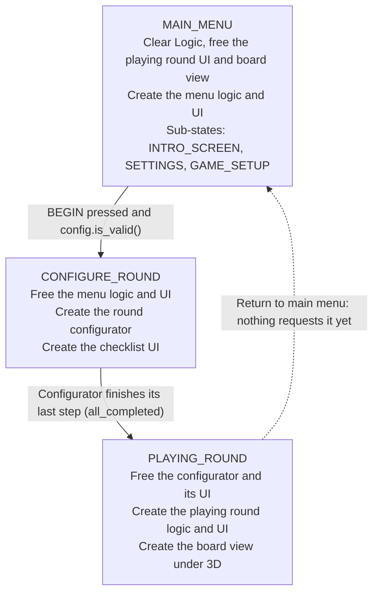

# Chess: Project Onboarding

A chess game in Godot 4.5 (Forward Plus), built on a reusable game-flow template: a main menu, a setup panel, a round being assembled step by step, and a playing round.

- **Working now:** boot to the main menu, press NEW GAME, press BEGIN. The round configurator builds the board, the two players and all 32 pieces, and the playing round shows a 3D board with sprite pieces. You can click a piece of the side to move to select it. Its square is highlighted, along with the squares it can move to (green) and the squares it targets but may not enter (red). Every piece moves: click a highlighted green square and the piece goes there. Moving onto an enemy piece captures it, and captured pieces line up beside the board. Press F5 to toggle the tactical view, which tints every square the side to move threatens.
- **Not built yet:** check, en passant, promotion, and game end. The END TURN button does nothing, so it is always white's turn.

## Project layout

Scenes are grouped by game state. Scripts are split into three trees that mirror each other: logic, UI (2D, `Control`), and world (3D).

| Path | What lives there |
| --- | --- |
| `project.godot` | Main scene is `Scenes/main_scene.tscn`. One autoload: `GameState`. One input action: `tactical_view` (F5). |
| `Scenes/main_scene.tscn` | The entry scene: `StateRouter`, `Logic`, `UI`, `3D`. |
| `Scenes/MainMenu/Core/` | `main_menu_logic.tscn` and `main_menu_ui.tscn`. |
| `Scenes/MainMenu/Panels/` | `round_config_panel.tscn`, the game setup panel. |
| `Scenes/ConfigureRound/` | Everything built while a round is assembled: `round_config.tscn`, `round_configurator_logic.tscn`, `round_configurator_ui.tscn`, and the system scenes the steps create (`state_manager.tscn`, `board_manager.tscn`, `player_manager.tscn`, `move_manager.tscn`, `selection_manager.tscn`). |
| `Scenes/PlayingRound/` | `playing_round_logic.tscn`, `playing_round_ui.tscn`, and the 3D scenes `board_view.tscn` and `piece_view.tscn`. |
| `Scripts/Autoload/` | `game_state.gd`, the top-level state machine. |
| `Scripts/MainScene/` | `main_scene.gd` (startup) and `logic.gd` (the system registry). |
| `Scripts/Logic/` | `state_router.gd`, `round_config.gd`, and one folder per area: `MainMenu/`, `RoundConfigurator/`, `PlayingRound/`. |
| `Scripts/Logic/PlayingRound/` | Round systems: `Board/`, `Players/`, `Pieces/` (with `Types/`), `Movement/`, `Selection/`, plus the turn and phase managers. |
| `Scripts/UI/` | 2D UI scripts, one folder per area: `MainMenu/`, `ConfigureRound/`, `PlayingRound/`. |
| `Scripts/World/PlayingRound/` | 3D view scripts: `board_view.gd`, `board_input.gd`, `piece_view.gd`, `piece_motion.gd`, `slide_envelope.gd`, `sprite_bounds.gd`. |
| `Assets/Pieces/` | Piece sprites, one folder per colour. See [Piece sprites](#piece-sprites). |

Two scripts sit outside this layout: `Scenes/MainMenu/Buttons/new_game_button.gd` lives beside the scenes, and `Scripts/MainMenu/Panels/begin_button.gd` lives in a `MainMenu` folder at the scripts root.

## Architecture principles

Every piece has one job, is given what it needs, and is created and freed by the same owner.

- **Logic, UI and world are separate.** Logic scenes go under `Logic`, 2D UI scenes under `UI`, 3D scenes under `3D`. Views read from logic through `initialize(...)` and send requests to it by calling its methods. Logic never reaches into a view.
- **Dependencies are injected.** Whoever creates a node calls its `initialize(...)` with what it needs. Nodes do not search the tree for collaborators. The only lookups a script makes are `@onready` references to its own children.
- **Systems are registered, not found.** Anything others need to reach registers with the `Logic` node (`logic.register("name", node)`) and is read with `logic.get_system("name")`.
- **Wiring uses signals.** Prefer a `[connection]` in the `.tscn` over connecting in code. Connections between nodes created at runtime are made in code by whoever wires them together.
- **The router owns top-level states only.** Main menu, configure round, playing round. Setup work that only exists briefly belongs in a configurator step.
- **Small scripts over big ones.** A new concern gets a new script, even a short one.
- **No `class_name`.** Scripts refer to each other with `preload(...)` constants, and subclasses extend by path (`extends "res://.../piece.gd"`). This avoids clashes with Godot's global names: an enum called `Side` collided with Godot's built-in `Side` enum, which is why the player enum is called `Team`.

## Main scene and the Logic registry

`main_scene.tscn` is the root of the running game:

| Node | Script | Job |
| --- | --- | --- |
| `MainScene` | `main_scene.gd` | On `_ready`, calls `state_router.initialize(logic, ui, world)`. |
| `StateRouter` | `state_router.gd` | Creates and frees each state's logic, UI and 3D scenes. |
| `Logic` | `logic.gd` | Parent of all logic scenes, and the registry of live systems. |
| `UI` | none | Full-screen `Control` that all UI scenes are added under. `mouse_filter` is Ignore so clicks reach the 3D board. |
| `3D` | none | `Node3D` that 3D scenes (the board view) are added under. |

`Logic` keeps a `systems` dictionary and has four functions:

- `register(name, node)` stores a system.
- `get_system(name)` returns it, or `null`.
- `release(name)` removes one system from the registry and the tree, then frees it.
- `clear()` empties the registry and frees every child of `Logic`. Children are removed from the tree immediately, so a new node with the same name can be added in the same frame.

Systems in the registry:

| Name | Registered by | Freed by |
| --- | --- | --- |
| `main_menu` | Router, when the main menu is created | Router, on `CONFIGURE_ROUND` |
| `round_config` | Router, the first time the menu enters `GAME_SETUP` | Round configurator, when its last step finishes |
| `round_configurator` | Router, on `CONFIGURE_ROUND` | Router, on `PLAYING_ROUND` |
| `state_manager` | `CreateStateManager` step | `logic.clear()` on `MAIN_MENU` |
| `board_manager` | `CreateBoardManager` step | `logic.clear()` on `MAIN_MENU` |
| `player_manager` | `CreatePlayerManager` step | `logic.clear()` on `MAIN_MENU` |
| `move_manager` | `CreateMoveManager` step | `logic.clear()` on `MAIN_MENU` |
| `selection_manager` | `CreateSelectionManager` step | `logic.clear()` on `MAIN_MENU` |
| `playing_round` | Router, on `PLAYING_ROUND` | `logic.clear()` on `MAIN_MENU` |

`clear()` does not touch UI or 3D. The router keeps its own references to the main menu UI, the round config panel, the checklist UI, the playing round UI and the board view, and frees them itself.

## State flow

`GameState` (autoload) holds the top-level state: `MAIN_MENU`, `CONFIGURE_ROUND`, `PLAYING_ROUND`. Requesting a change: `GameState.state_change_requested.emit(GameState.State.X)`. `GameState` sets `current_state` and emits `state_changed`, and the router reacts.

In order:

1. **Startup.** `main_scene.gd` calls `state_router.initialize(logic, ui, world)`, which runs the `MAIN_MENU` branch for the starting state.
2. **NEW GAME.** The menu's own state changes to `GAME_SETUP`. The router creates the `round_config` node (once) and adds the config panel. `GameState` is still `MAIN_MENU`.
3. **BEGIN.** If `round_config.is_valid()` is true, the button requests `CONFIGURE_ROUND`.
4. **Configure.** The router frees the menu, then creates the round configurator and its checklist UI. The configurator runs its steps, building the board, players and pieces.
5. **Handoff.** On `all_completed` the configurator releases `round_config` and requests `PLAYING_ROUND`.
6. **Play.** The router frees the configurator and its UI, creates the playing round logic and UI, and creates the board view under `3D`, all wired to the systems already in the registry.

## Main menu

The main menu is a logic scene plus a UI scene, with its own small state machine that decides which panel shows.

- **`main_menu_logic.tscn`**
  - `MainMenu` (`main_menu_logic.gd`) exposes `menu_state`.
  - `MainMenuState` (`main_menu_state.gd`) has the states `INTRO_SCREEN`, `SETTINGS` and `GAME_SETUP`, plus `change_state(state)` and `go_back()`, which returns to the previous state.
  - `MainMenuInput` (`main_menu_input.gd`) calls `go_back()` on `ui_cancel` (Escape).
- **`main_menu_ui.tscn`**
  - `Buttons/NewGameButton` changes the menu state to `GAME_SETUP`.
  - `Panels` is an empty `Control` that panels are added under.

The router listens to `MainMenuState.state_changed`:

| Menu state | Router does |
| --- | --- |
| `INTRO_SCREEN` | Frees the config panel. |
| `SETTINGS` | Frees the config panel. Nothing switches to this state yet. |
| `GAME_SETUP` | Creates the `round_config` node if it does not exist, then adds the config panel under `Panels`. |

Closing the panel with Escape frees the panel but keeps the `round_config` node, so choices made earlier survive when the panel is opened again.

## Round config panel and round config

The panel is the place for setup options. It ships empty.

`round_config_panel.tscn`:

| Node | Script | Job |
| --- | --- | --- |
| `RoundConfig` (root) | `round_config_panel.gd` | `initialize(config)` hands the `round_config` node to BEGIN. Exposes `options`. |
| `Panel/MarginContainer/Title` | none | Label: "CONFIGURE GAME". |
| `Panel/OptionsScroll/Options` | none | Empty `VBoxContainer` in a scroll container. Config controls go here. |
| `Panel/BeginButton` | `begin_button.gd` | If `config.is_valid()` is true, requests `CONFIGURE_ROUND`. |

`round_config.tscn` (`round_config.gd`) stores the choices:

- `settings`: a dictionary of choices.
- `set_setting(key, value)` and `get_setting(key, default)`: write and read one choice.
- `is_valid()`: returns `true`. Change it to keep BEGIN from working until required settings are set.

Controls write with `config.set_setting(...)`. Configurator steps read with `configurator.config.get_setting(...)`.

## Round configurator

The round configurator runs a list of steps in order to build the systems a round needs, then hands off to the playing round. It exists only during `CONFIGURE_ROUND`.

**Structure.** `round_configurator_logic.tscn` is a `RoundConfigurator` node whose children are the steps. Child order is run order. Each step has one function, `run(configurator)`. The configurator exposes `logic` (the registry) and `config` (the `round_config` node). Steps build logic only; they never create UI or 3D nodes, because those scenes do not exist until the playing round starts.

| Order | Step | Script | What it does |
| --- | --- | --- | --- |
| 1 | `CreateStateManager` | `create_state_manager_step.gd` | Instantiates `state_manager.tscn` under `Logic` and registers it as `state_manager`. |
| 2 | `CreateBoardManager` | `create_board_manager_step.gd` | Instantiates `board_manager.tscn` (64 squares) and registers it as `board_manager`. |
| 3 | `CreatePlayerManager` | `create_player_manager_step.gd` | Instantiates `player_manager.tscn` (white and black) and registers it as `player_manager`. |
| 4 | `CreatePieces` | `create_pieces_step.gd` | Creates the 32 starting pieces, gives each to its player and places it on its starting square. |
| 5 | `AddPlayersToTurnOrder` | `add_players_to_turn_order_step.gd` | Adds white then black to `TurnManager` and starts the first turn (white). |
| 6 | `CreateMoveManager` | `create_move_manager_step.gd` | Instantiates `move_manager.tscn`, registers it as `move_manager`, and gives it the board and player managers. |
| 7 | `CreateSelectionManager` | `create_selection_manager_step.gd` | Instantiates `selection_manager.tscn`, registers it as `selection_manager`, and gives it the turn, player and move managers. |

**How it runs.**

- `_ready()` calls `run_steps()` deferred, so steps can add nodes to `Logic` after the configurator has finished entering the tree.
- `run_steps()` runs `await step.run(self)` for each child. A step is done when `run()` returns, so a step that needs time can await a signal or timer inside `run()`.
- After each step the configurator emits `step_completed(step)`. After the last one it emits `all_completed`.
- On `all_completed` it releases `round_config` and requests `PLAYING_ROUND`.

**Checklist UI.** `round_configurator_ui.tscn` adds one read-only checkbox per step, labelled from the node name (`CreateBoardManager` becomes "Create Board Manager"), and ticks it on `step_completed`. Steps know nothing about the UI.

## Chess logic

All of these are plain `Node`s under `Logic`, built by configurator steps and freed by `logic.clear()`.

### Board manager

`board_manager.gd` (`Scripts/Logic/PlayingRound/Board/`) owns the 64 squares.

- On `_ready` it creates one square node per square as children, named `a1` to `h8`, and indexes them in `squares` by name.
- `remove_piece(piece)` takes a piece off the board and clears both sides of the link.
- `is_threatened(square, by_team)` returns whether any piece of that team on the board threatens the square (see [Threats](#pieces)).
- `get_square("e4")` looks a square up by name. `get_square_at(file, rank)` looks it up by index (0–7 each, `0, 0` is a1) and returns `null` off the board. `is_on_board(file, rank)` and `to_notation(file, rank)` are helpers.
- `place_piece(piece, "e4")` puts a piece on an empty square and keeps both sides linked (`square.piece` and `piece.square`). If the piece was on another square, that square is cleared. It does nothing if the target is occupied.

Each square (`square.gd`) holds `file`, `rank`, `square_name`, `is_light` (a1 is dark) and `piece` (`null` when empty), with `is_empty()`.

### Players

`player_manager.gd` (`Scripts/Logic/PlayingRound/Players/`) defines `enum Team { WHITE, BLACK }` and creates two player nodes as children, `White` and `Black`.

- `get_player(id)` (`"white"` or `"black"`), `get_player_by_team(team)`, and `get_player_ids()`, which returns ids in move order (white first).

Each player (`player.gd`) holds `player_id`, `team`, `is_human` (always `true` for now), and the pieces it owns:

- `pieces` lists the player's pieces. The pieces are also children of the player node, so the player owns them in the tree.
- `add_piece(piece)` and `remove_piece(piece)` emit `piece_added` and `piece_removed`. `has_piece(piece)` and `get_pieces_of_type(type)` read the list.
- `captured_pieces` lists the enemy pieces this player has captured. They are also children of the player node. `add_captured(piece)` inserts a piece after the last captured piece of its group and emits `piece_captured`. Groups follow `CAPTURE_ORDER`: pawns, knights, bishops, rooks, queens; a type not listed (the king, which can be captured while check is not built) goes last. So capturing a pawn, then a knight, then a pawn gives pawn, pawn, knight.

### Pieces

Every piece extends one base script, so each piece type keeps its own movement rules in its own file.

- **Base:** `Scripts/Logic/PlayingRound/Pieces/piece.gd` defines `enum PieceType { KING, QUEEN, ROOK, BISHOP, KNIGHT, PAWN }` and the shared state: `piece_type`, `team`, `square`, `has_moved`. `initialize(team)` sets the team. `get_type_name()` returns e.g. "Pawn".
- **Movement rules are per type.** Each type overrides two functions:
  - `get_target_squares(board_manager)`: every on-board square its pattern reaches from where it stands, before validation.
  - `can_move_to(square, board_manager)`: whether it may move to one of those squares. `board_manager` is there for rules that look at other squares, such as a pawn's path.

  The base turns these into `get_moves(board_manager)` (targets that pass `can_move_to`) and `get_blocked_moves(board_manager)` (targets that fail it). The base versions of both overrides return nothing.
- **Types:** `Pieces/Types/` has `king.gd`, `queen.gd`, `rook.gd`, `bishop.gd`, `knight.gd` and `pawn.gd`. Each extends the base by path and sets its `piece_type` in `_init()`.
  - **Knight** (done): targets the eight L-shaped jumps that land on the board (`OFFSETS`); pieces in between do not block it. A move is blocked only if the square holds a friendly piece.
  - **Pawn** (done): targets one square forward, plus two forward while `has_moved` is false. Forward is +1 rank for white and −1 for black (`get_forward()`). A straight move is blocked if the target or any square between it and the pawn holds a piece of either colour. It also targets each diagonal-forward square that holds an enemy piece, and captures there; empty diagonals are not targets, so they are not highlighted. En passant and promotion are not built; a pawn on the last rank has no straight targets.
  - **Bishop** (done): slides along the four diagonals (`DIRECTIONS`) using `get_sliding_targets`. A move is blocked only if the square holds a friendly piece. A bishop never changes square colour, so it does not track it; `square.is_light` gives the colour when needed.
  - **Rook** (done): slides along its file and rank (`DIRECTIONS`) using `get_sliding_targets`. A move is blocked only if the square holds a friendly piece. `has_moved` is already set after its first move, which castling will need.
  - **Queen** (done): slides along its file, rank and both diagonals (eight `DIRECTIONS`) using `get_sliding_targets`. A move is blocked only if the square holds a friendly piece.
  - **King** (done): targets the eight neighbouring squares that are on the board (`OFFSETS`). A step is blocked only if the square holds a friendly piece. It can step onto a threatened square, since check is not built.
  - **Castling** (in `king.gd`): moves the king two squares toward a rook and the rook to the square the king crossed. Kingside: king to g, rook h to f. Queenside: king to c, rook a to d (`CASTLING`).
	- **Target:** the castling square is a target only while the king and that corner's rook have never moved (`has_moved`), the corner holds a friendly rook (`get_castling_rook`), and none of the king's own pieces stand between them (`has_friendly_between`). Otherwise it is not shown at all, to keep the board readable.
	- **Allowed** (`can_castle`) only if every square between the king and the rook is empty, and no opponent piece threatens the king's square, the square it crosses, or the square it lands on (`board_manager.is_threatened`). Queenside the b-file square must be empty but may be threatened, because the king never crosses it. A target that fails these (an enemy piece in between, or a threatened square) shows as blocked (red).
	- **The rook moves too:** `get_companion_move(target, board_manager)` returns the rook and its square; `move_manager` moves it after the king.
	- **Threats:** the king overrides `get_threatened_squares` to return only its neighbours (castling never captures). This is also what stops two kings asking each other about castling without end.

**Sliding helper.** `get_sliding_targets(board_manager, directions)` in `piece.gd` walks from the piece along each `Vector2i(file step, rank step)` and returns every square up to and including the first occupied one. Squares behind a piece are not targets, so they are not highlighted. Bishops, rooks and queens each use it with their own `DIRECTIONS`.

`has_moved` starts `false` and is set by `move_manager` after a piece's first move.

**Companion moves.** `get_companion_move(target_square, board_manager)` returns a second piece that moves with this one, as `{ "piece", "square" }`, or `{}`. The base returns `{}`; the king uses it for castling.

**Threats.** `get_threatened_squares(board_manager)` returns the squares a piece would capture on: empty squares and squares holding an enemy, never squares holding a friendly piece or behind a blocker. The base returns `get_moves()`, which is right for every type except the pawn. The pawn overrides it to return its two diagonal-forward squares (empty or enemy) and not the squares straight ahead. `player.get_threatened_squares(board_manager)` combines the threats of all that player's pieces on the board.
- **Creation:** `create_pieces_step.gd` maps each `PieceType` to its script in `PIECE_SCRIPTS` and creates a piece with `PIECE_SCRIPTS[type].new()`, which runs the subclass `_init()`. Pieces are named after their type and starting square, e.g. `Pawn_e2`, `King_e8`. White starts on ranks 1–2, black on ranks 7–8.

### Turns and phases

`state_manager.tscn` (`states.gd`) exposes two children:

- **`TurnManager`** keeps `turn_order` (player ids). `add_player(id)` adds an id without changing the turn. `next_turn()` moves to the next id, wrapping at the end. `change_turn(id)` emits `turn_changed(id)`. `get_current_player()` returns the current id, or `null` before the first turn.
- **`PhaseManager`** has the phases `START_PHASE`, `MAIN_PHASE`, `END_PHASE` and `STANDBY` (the starting phase). `advance_phase(phase)`, or emitting `phase_change_requested(phase)`, sets the phase and emits `phase_changed`. No chess code uses phases yet.

### Move manager

`move_manager.gd` (`Scripts/Logic/PlayingRound/Movement/`) carries out moves and captures.

- `initialize(board_manager, player_manager)`.
- `move_piece(piece, square)` moves the piece only if `square` is in `piece.get_moves(board_manager)`; otherwise it returns `false` and nothing changes. It reads `piece.get_companion_move()` first, while the piece still stands on its square. If the square holds an enemy piece, that piece is captured (see below). Then `place()` puts the piece on the square with `board_manager.place_piece`, sets `has_moved` and emits `piece_moved(piece, from_square, to_square)`. If there is a companion move (the rook when castling), it is placed the same way, with its own `piece_moved`. Returns `true`.
- **Capturing** (`capture(capturing_piece, captured_piece)`): the captured piece is taken off the board (`board_manager.remove_piece`), removed from its owner (`remove_piece`), and given to the capturing player (`add_captured`). After `piece_moved`, the manager emits `piece_captured(captured_piece, capturing_piece, capturing_player)`.

### Selection manager

`selection_manager.gd` (`Scripts/Logic/PlayingRound/Selection/`) holds the selected piece.

- `initialize(turn_manager, player_manager, move_manager)`.
- With a piece selected, `select_square(square)` first asks `move_manager.move_piece(selected_piece, square)`. If the piece moved, the selection is cleared. Otherwise it falls through to selecting:
- `select_square(square)` selects the piece on that square if it belongs to the player whose turn it is. Clicking the selected piece again, an empty square, an opponent's piece, or off the board clears the selection.
- `can_select(piece)` is the turn check. `clear_selection()` clears it.
- Emits `selection_changed(piece)`, or `selection_changed(null)` when cleared. The selection is cleared whenever the turn changes.

## Playing round

The playing round does not own its systems. It receives the registry, and its UI and 3D view are wired to the systems the configurator built.

- **Logic (`playing_round_logic.tscn`).** `PlayingRound` → `EventCoordinators` → `GameInitializer`. The router calls `playing_round.initialize(logic)`, which passes the registry down. `GameInitializer` only stores it.
- **UI (`playing_round_ui.tscn`).** The router calls `initialize(state_manager, phase_manager, turn_manager)`. The root `Control` has `mouse_filter` set to Ignore so clicks reach the 3D board.
  - `PhaseLabel` shows the current phase name and updates on `phase_changed`.
  - `TurnLabel` shows the current player id ("white") on `initialize` and on `turn_changed`.
  - The END TURN button stores the state manager. Pressing it does nothing yet.
- **3D (`board_view.tscn`).** The router adds it under `3D` and calls `initialize(board_manager, selection_manager, move_manager, turn_manager, player_manager)`. See below.
- **Teardown.** On `MAIN_MENU` the router frees the UI and the board view. `logic.clear()` frees the playing round logic and every round system.

## 3D board view

`board_view.tscn` (`Scripts/World/PlayingRound/board_view.gd`) draws the board from the board manager and never changes board state.

| Node | Job |
| --- | --- |
| `BoardView` (root) | Builds the squares and pieces, places the camera, wires input to the selection manager, highlights the selection and its moves, and moves piece views. |
| `Squares` | One `MeshInstance3D` box per square, named `a1`–`h8`, kept in `square_views`. |
| `Pieces` | One `piece_view.tscn` per piece, kept in `piece_views` (keyed by piece). |
| `Camera3D` | Placed at `(0, 8, 6)` looking at the board centre, viewing from white's side. |
| `DirectionalLight3D` | The scene's only light. |
| `BoardInput` | Turns clicks into squares (see [Clicking](#clicking)). |

**Layout.** The board is centred on the origin with one world unit per square (`square_size`). Files a–h run along +X; ranks 1–8 run along −Z, so rank 1 is nearest the camera. The square tops are at y = 0. `square_to_position(file, rank)` and its inverse `position_to_square(local_position)` convert between the two.

**Inspector settings:** `square_size`, `square_thickness`, `light_color`, `dark_color`, `selected_color`, `move_color`, `blocked_color`, `threat_color`, `threat_strength` (0.45), `threatened_piece_color`, `threatened_piece_strength` (0.7), `captured_scale` (0.5), `captured_margin_front` (0.6), `captured_margin_back` (1.6), `captured_spacing` (0.3), `captured_group_spacing` (0.6).

**Selection highlight.** On `selection_changed`, every highlighted square gets its normal colour back. Then the selected piece's square is drawn in `selected_color`, its `get_moves()` squares in `move_color`, and its `get_blocked_moves()` squares in `blocked_color`.

**Square colour layers.** Each square shows the top layer that covers it: selection highlights (`selection_highlights`), then tactical view tints (`threat_highlights`), then its plain light or dark colour. `refresh_squares()` reapplies all 64 whenever a layer changes.

**Tactical view.** The `tactical_view` input action (F5) toggles it. While it is on, every square in the current player's `get_threatened_squares()` is tinted: empty squares toward `threat_color` (orange) and squares holding an enemy piece toward `threatened_piece_color` (red). Tints are mixed into the square's own colour by `threat_strength` and `threatened_piece_strength`, so the light and dark pattern still shows. The view recomputes on toggle, after every move, and on `turn_changed`. A selected piece's highlights draw over the tints and the tints return when the selection clears.

**Captured lines.** On `move_manager.piece_captured`, the captured piece's view stops being clickable, waits for the capturing piece's move to finish (`get_move_duration()`), then moves to its place in the capturing player's line and shrinks to `captured_scale`. Pieces already in the line move at the same time to make room, so a new pawn slides in after the other pawns and pushes later groups along. `get_captured_positions(player)` lays the line out along the board's width from the a-file side: `captured_spacing` between pieces of the same type, `captured_group_spacing` before a new type. The camera views from white's side, so white's line runs in front of rank 1 (`captured_margin_front` squares out) and black's behind rank 8 (`captured_margin_back`, further out so the back-rank pieces do not hide it).

**Moving pieces.** On `move_manager.piece_moved`, the board view calls `move_to(piece_position(square))` on the piece's view (`piece_position` is the square centre at y = 0), which animates it there. See [Piece motion](#piece-motion).

### Clicking

`board_input.gd` handles left clicks in `_unhandled_input` and emits `square_clicked(square)`, which `BoardView` connects to `selection_manager.select_square`. It also emits `tactical_view_toggled` when the `tactical_view` action is pressed.

1. The click position is stored, and the work is done in `_physics_process`, where physics queries are safe.
2. A ray from the camera is tested against piece click bodies. If it hits one, the result is that piece's square. This means clicking the top of a tall piece selects that piece, not the square behind it.
3. Otherwise the ray is intersected with the board plane (y = 0) and converted to a square, or `null` off the board.

For clicks to reach `_unhandled_input`, the full-screen `UI` root and the playing round UI root both have `mouse_filter = 2` (Ignore). Any new full-screen `Control` added during play needs the same.

### Piece views

`piece_view.tscn` (`piece_view.gd`) shows one piece. Its origin sits on the square centre at board level.

| Node | Job |
| --- | --- |
| `Sprite` | `Sprite3D` with the piece image. Billboard mode Enabled, so it always faces the camera; alpha cut Discard, so overlapping pieces sort correctly. |
| `Shadow` | A flat radial-gradient quad just above the board, scaled to the piece's base. |
| `ClickBody/ClickShape` | An upright box the size of the piece, used by `BoardInput`. |
| `Motion` | `piece_motion.gd`: animates moves. See [Piece motion](#piece-motion). |

All three stay hidden or disabled if the piece has no image.

**How a piece is drawn:**

1. **Image.** Loaded from `Assets/Pieces/<Team>/<team>_<type>.png`. If the file does not exist, nothing is shown.
2. **Measure.** `sprite_bounds.gd` measures the image's solid pixels (alpha ≥ 0.5) on a copy scaled to 256 px tall and caches the result per file. It returns the solid area, the base's half-width (widest row in the bottom 15% of the piece) and the base's horizontal centre.
3. **Crop and scale.** The sprite draws only the solid area (`region_rect`), scaled so the piece is `king_height × HEIGHT_RATIOS[type]` tall. Empty space around the piece in the image has no effect.
4. **Anchor.** The sprite is offset so the bottom of the base sits on the node origin, and shifted sideways so the base's centre (not the image's) is over it. The billboard pivots around this point.
5. **Forward shift.** The bottom of the sprite is the front edge of the base, so the sprite is moved toward the camera (+Z) by `base_forward × base half-width` to centre the visible base on the square.
6. **Mirroring.** Knights and bishops (`FLIPPED_ON_KINGSIDE`) that start on files e–h are flipped horizontally, so each pair faces each other. This is decided once from the starting square.
7. **Shadow and click box** are sized from the base half-width and piece height.

**Piece heights.** Each image fills its canvas, so the image does not say how big the piece is. Heights are `king_height` (default 1.4 world units) times:

| Piece | Ratio | Height at 1.4 |
| --- | --- | --- |
| King | 1.0 | 1.40 |
| Queen | 1.0 | 1.40 |
| Bishop | 0.85 | 1.19 |
| Knight | 0.72 | 1.01 |
| Rook | 0.67 | 0.94 |
| Pawn | 0.53 | 0.74 |

These started from FIDE's recommended heights (king 9.5 cm, queen 8.5, bishop 7, knight 6, rook 5.5, pawn 5); the queen, bishop, knight and rook were then raised by eye.

**Inspector settings on `piece_view.tscn`:** `king_height`, `base_forward` (0.5; 0 puts the base's front edge on the centre, 1 its true centre), `shadow_scale` (shadow radius as a multiple of base half-width, 1.4), `shadow_strength` (0.55).

### Piece motion

`piece_motion.gd` (the `Motion` child of `piece_view.tscn`) animates a piece from square to square. `piece_view.initialize()` hands it the view, sprite, shadow and piece type; `piece_view.move_to(position, delay, scale)` starts a move, optionally after `delay` seconds and scaling the view to `scale` on the way.

- The view slides from its current position to the target. Hopping pieces take `hop_duration` seconds and ease in and out on a sine. Every other piece takes `slide_duration` and follows an ADSR speed envelope (`slide_envelope.gd`):
  - **Attack** (`slide_attack`): speed ramps from 0 to its peak.
  - **Decay** (`slide_decay`): speed falls from the peak to the sustain level.
  - **Sustain** (`slide_sustain_level`): speed holds at this fraction of the peak.
  - **Release** (`slide_release`): speed falls to 0 as the piece lands.

  Attack, decay and release are fractions of `slide_duration`; sustain fills the rest. If they add up to more than 1 they are shrunk to fit. Position is the area under the speed curve, scaled so the piece always lands exactly on the target. The curve is rebuilt on every move, so Inspector changes apply on the next move. Because it starts from the current position, a new move begun mid-animation carries on from wherever the piece is.
- Types listed in `HOP_HEIGHTS` also arc: the sprite rises on a parabola that peaks at that height halfway through the move, while the shadow stays on the board and shrinks to `shadow_scale_at_peak`. Only the knight is listed (0.9 world units). Every other type slides.
- The logic moves instantly; only the view animates.

**Inspector settings on `Motion`:** `hop_duration` (0.45), `slide_duration` (0.25), `shadow_scale_at_peak` (0.6), `slide_attack` (0.15), `slide_decay` (0), `slide_sustain_level` (1), `slide_release` (0.15).

**Known limitation.** The forward shift is along +Z, toward the camera on white's side. If the camera moves to black's side, the shift has to point the other way.

## Piece sprites

`Assets/Pieces/White/` and `Assets/Pieces/Black/` hold one PNG per piece, named `<team>_<type>.png` in lower case: `white_pawn.png`, `black_knight.png`, and so on. All twelve exist. To change a piece's art, replace its file; no code changes are needed. Images need a transparent background, should show the piece upright and centred, and for knights and bishops should face the way the queenside piece (b- or c-file) should face.

## How to extend

**Add a config option**

1. Add a control under `Panel/OptionsScroll/Options` in `round_config_panel.tscn`, or create it from `round_config_panel.gd` and add it to `options`.
2. Give it the config in `round_config_panel.initialize(config)` and have it call `config.set_setting("key", value)`.
3. If the option is required, check it in `round_config.is_valid()`.
4. Read it in a configurator step with `configurator.config.get_setting("key")`.

**Add a round setup step**

1. Write a script with `func run(configurator)`. Reach systems through `configurator.logic.get_system("name")` and choices through `configurator.config`.
2. Add a child node with that script under `RoundConfigurator` in `round_configurator_logic.tscn`. Its position among the children sets when it runs; place it after the steps that build the systems it needs.
3. Nothing else changes. The checklist picks it up by name.

**Add a system that lives for the round**

1. Make a scene for it.
2. Add a step that instantiates it under `Logic`, calls `logic.register("name", node)`, and calls any `initialize()` it needs.
3. Read it elsewhere with `logic.get_system("name")`. `logic.clear()` frees it on `MAIN_MENU`.

**Write a piece's movement rules**

1. Open the piece's script in `Scripts/Logic/PlayingRound/Pieces/Types/`.
2. Fill in `get_target_squares(board_manager)`: start from `square.file` and `square.rank`, step with `board_manager.get_square_at(file, rank)` (it returns `null` off the board), and return every square the pattern reaches. `knight.gd` is the example.
3. Fill in `can_move_to(square, board_manager)`: check `square.piece` and `piece.team`, and any squares on the way. `pawn.gd` is the example of checking a path.
4. Nothing else changes. Highlighting and moving read `get_moves()` and `get_blocked_moves()`.
5. Shared helpers (for example, sliding along a direction) belong in `piece.gd` so every type can use them.

**Show something new on the 3D board**

1. Add it to `board_view.tscn` or a new scene created by `BoardView`.
2. Pass it the logic it reads through `initialize(...)`, and react to logic signals (`selection_changed`, `piece_added`, and so on).
3. Use `square_to_position(file, rank)` to place things on squares.

**Add a top-level game state (credits, for example)**

1. Add a value to `GameState.State`.
2. Add a branch to `_on_state_changed` in `state_router.gd`, with `create_` and `destroy_` functions like the existing ones: logic through the registry, UI and 3D through router variables.
3. Have something request it with `GameState.state_change_requested.emit(...)`.

**Add a main menu panel**

1. Add a value to `MainMenuState.State`, or use `SETTINGS`.
2. Add a button that calls `menu_state.change_state(...)`, following `new_game_button.gd`.
3. Handle the state in the router's `_on_menu_state_changed`, creating the panel under `main_menu_ui_instance.panels` and freeing it in the other states.

## Known gaps

These come from reading the code. They have not been confirmed by running the game.

- **Kings can be captured,** since check is not built. A captured king goes to the end of the line.
- **END TURN does nothing,** so it is always white's turn and black's pieces cannot be selected.
- **No way back to the main menu.** The router's `MAIN_MENU` branch works, but nothing requests that state after startup.
- **No settings panel.** `MainMenuState.SETTINGS` exists, but there is no button or panel for it.
- **The checklist may flash by.** Every step runs instantly, so the configure state finishes in one frame and its UI is freed right away. The checklist shows once a step awaits something.
- **The router creates `round_config`.** It is created when the menu enters `GAME_SETUP`. The main menu would be the more natural owner.
- **Same-state guards do nothing.** In `GameState.change_state` and `PhaseManager.advance_phase`, the `if current == new: pass` check does not return, so a repeated request still emits. `MainMenuState.change_state` returns correctly.
- **Unused pieces.** `TurnManager.turn_change_requested` is declared but never connected. Phases are not used by the chess code. `GameInitializer` only stores the registry.
- **Captured lines assume white's view,** like the forward shift: black's line is placed behind the board because the camera is on white's side.
- **Forward shift assumes white's view.** See [Piece views](#piece-views).
